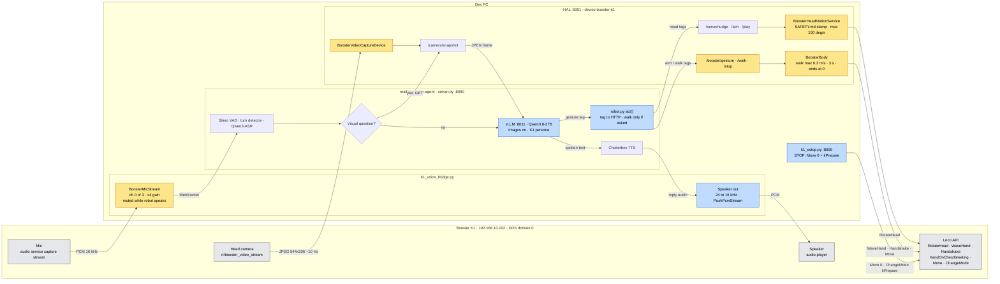

# Booster K1: voice agent ↔ HAL ↔ robot loop

How the 2026-11-25 setup connects a real Booster K1 to the realtime voice agent
(`/home/tdam/tien-project/realtime-voice-agent`) through HAL running on a dev PC.
Yellow = code added in HAL, blue = added in the voice agent or the dev tools
(`robots/booster-k1/tools/`), gray = the robot. Everything is uncommitted.

How to run it: [robots/booster-k1/docs/run-k1-voice-pipeline.md](../robots/booster-k1/docs/run-k1-voice-pipeline.md).
Robot facts: `/home/tdam/tien-project/booster-k1/`.

## What was added in HAL

| File | Role in the loop |
|------|------------------|
| `drivers/motors/booster_service.py` | Head driver behind `/servo/*` (clamping, ≤ 150°/s glide), plus `BoosterBody` for arm gestures and capped walking. `init_booster_channel()` shares one DDS connection with the camera |
| `routes/booster_body.py` | `/booster/gesture`, `/booster/walk`, `/booster/stop`, `/booster/status`, which the agent calls |
| `drivers/camera/booster_capture_device.py` | behind `/camera/snapshot`: reads Booster's JPEG stream |
| `drivers/voice/_internal/booster_mic.py` | the K1 mic stream (`BoosterMicStream`), imported directly by the bridge |
| `runtime.py`, `drivers/motors/factory.py`, `drivers/camera/factory.py`, `config.py`, `drivers/voice/voice_service.py`, `board/boards.json` | register these drivers and routes for the `booster-k1` device |

## Gesture tags the agent can emit

| Tag | HAL call |
|-----|----------|
| `[nod]`, `[shake]` | `POST /servo/play` (`nod`, `headshake`) |
| `[look_left]`, `[look_right]`, `[look_up]`, `[look_down]` | `POST /servo/nudge` |
| `[center]` | `POST /servo/aim` (`center`) |
| `[wave]`, `[handshake]`, `[greet]` | `POST /booster/gesture` |
| `[step_forward]`, `[step_back]`, `[turn_left]`, `[turn_right]` | `POST /booster/walk` (1.5 s; only if the user asked to move) |

## Notes

- **HAL doesn't carry the audio.** The bridge reads the mic and plays speech on
  the robot directly; HAL serves only the camera and motion. HAL's own voice
  pipeline also supports the K1 mic (`HAL_AUDIO_INPUT_BACKEND=booster`), but it
  wasn't used in this loop.
- **The stop page bypasses HAL.** It has its own DDS connection, so it still
  works if HAL or the agent hangs.
- **Mode:** head, arm and walk commands only work while the robot is in
  walking mode (`kWalking`). HAL never changes the robot's mode.
